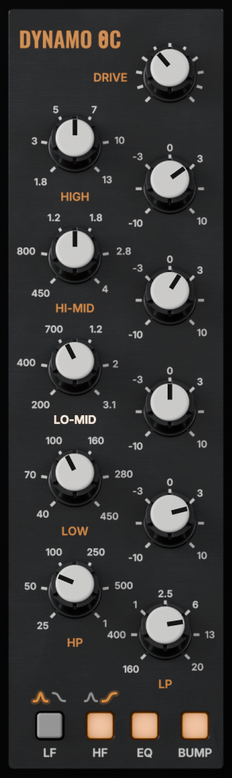
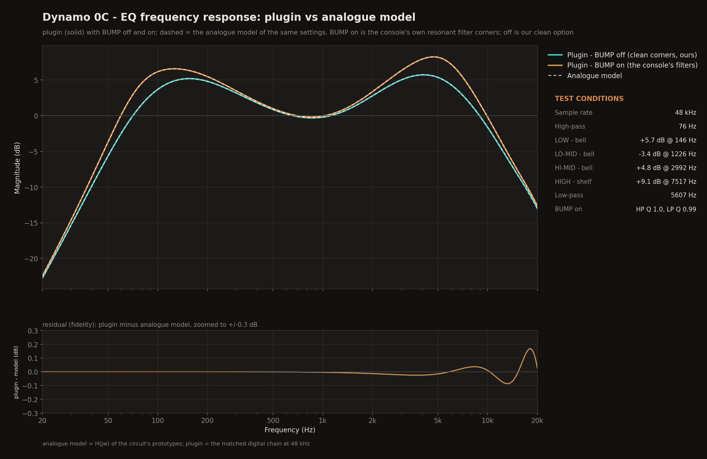

# Dynamo 0C EQ

<p align="center"></p>

Dynamo 0C is a warm, console-style **4-band parametric equaliser** that runs on Linux as a stereo **LV2** plugin, with
its own rendered interface: a one-slot 500-series module in brushed aluminium. It pairs four proportional-Q bands with
high- and low-pass filters and an asymmetric, analogue-style channel drive. Every band is built from the analogue
circuit's transfer function, so its curve keeps its analogue shape all the way up to the top of the spectrum.

This is an independent product and is **not affiliated with, endorsed by, or connected to any mixing-console
manufacturer**.

---

> **Full disclosure: This plugin was vibe-coded.**
>
> Dynamo 0C was developed by a musician/audio engineer ([NiLace](https://github.com/NiLace)) directing [Claude](https://claude.ai) (Anthropic's AI) through natural language conversation. The author described what the plugin should do, how it should sound, and how it should look. Claude wrote the C code, the DSP algorithms, the UI rendering, the build system, and this README.
>
> The author is not a professional programmer, though he can read C. Every line of code in this project was generated by AI, then tested and validated by the author in real-world audio production with [Ardour](https://ardour.org) on Linux.
>
> If AI-generated code is a concern for you, this is your notice. The plugin works and it sounds good — but you should know how it was made.

---

## What it is

The channel equaliser of a classic analogue mixing console: four bands, each with its own frequency and gain, a
high-pass and a low-pass filter, and nothing else to fiddle with. Desks like it were built for speed — an engineer
working down a whole desk of channels has no time for a Q control — so the bands are voiced to sound right wherever you
put them: a small move is wide and gentle, a big one focuses on its own.

That is what Dynamo 0C keeps: an EQ that feels like turning knobs on a desk rather than dialling numbers into a plugin.
Smooth, forgiving, and hard to make sound harsh.

## How it is modelled

- **The bands and the filters** come from the circuit's analogue transfer function `H(s)`, with the potentiometers'
  real law and the component values of the original design. Each is then matched to the analogue response, so the
  curves keep their shape right up to Nyquist instead of pinching in ("cramping") near the top the way a naïve digital
  EQ does — at the session's own rate, with **no oversampling** for the EQ.
- **The tables behind the knobs** are the potentiometers' wiper positions, derived from the circuit: a frequency knob
  sweeps its band on a logarithmic scale, as on the hardware.
- **The bands are proportional-Q**: the Q follows the gain, about **0.6** at full boost (0.57–0.64) and about **0.45**
  at full cut, and a small move is broader still, more so towards the top of each band's range. So a band always reads
  as broad and musical; it focuses, but never becomes a surgical notch.
- **The channel drive** is a bounded, asymmetric soft saturation followed by a DC blocker. Its shape is our own,
  specified by three things you can hear: where it saturates on the positive side, where on the negative side (higher,
  which is what brings in the even harmonics), and its small-signal gain.

<p align="center"></p>

The curve above is a full EQ pass with the high-pass and low-pass filters engaged. The plugin (solid) sits right on top
of the analogue model it is built from (dashed): they agree to within 0.2 dB across the whole spectrum. The orange
curve has **BUMP** on: the console's own resonant filter corners, described below.

## The front panel

Eleven knobs and four buttons, laid out like a 500-series module:

- **High / Hi-Mid / Lo-Mid / Low** — frequency (left column) and gain (right column) per band; a gain knob at its
  centre is 0 dB. **Low** and **High** can be a **bell** or a **shelf**: a bell boosts or cuts a hump centred on the
  frequency, a shelf tilts everything past it. Rule of thumb: a bell to fix a spot, a shelf to tilt the balance.
  **Lo-Mid** and **Hi-Mid** are always bells.
- **HP / LP** — the high-pass clears the lows below its corner (rumble, mud), the low-pass rolls off the highs above it
  (fizz, hiss). Each engages as you turn it in from its off end.
- **DRIVE**, top right — the channel drive. At **0** it is off and costs nothing; it switches in as you move it.
- **LF / HF** — bell or shelf for the Low and High bands: **pressed is shelf, released is bell**. The two symbols above
  each button show which one is selected, lit in amber, and you can click the symbol you want.
- **EQ** — engages the four bands (the filters work either way).
- **BUMP** — the console's resonant knee on both filters; off gives clean corners (see *Our mods*).
- **The title**, «DYNAMO 0C», is the **bypass**: amber while the plugin runs; click it and the whole panel goes dark,
  the title turns pale. It is the same control as your DAW's bypass button for the plugin: either one sets the other.

A band's name lights in **amber once its gain is moved off 0 dB** and stays white while it sits at 0 dB or EQ is out;
DRIVE's name is amber while the drive is on. With **EQ out**, the four bands' knob caps go dark and those knobs do
not turn until EQ is back in. (A band at 0 dB is still in the signal path, as on the console: its
analogue curve is not perfectly flat even at the centre detent, so it is never switched out.) Drag a knob up or down to set it, hold **Shift** for fine adjustment, and
**double-click** to snap it back to its default; its value shows while you move it, computed from the circuit model
(the numbers printed around each knob are the console's legend, not a measurement). The window is resizable and the
panel scales uniformly.

### The drive

DRIVE always runs **4x oversampled**, with a half-band filter and antiderivative anti-aliasing: that keeps its
harmonics from folding back below our target over the whole musical range, up to a sustained 17 kHz at full drive.
There is nothing to set. None of its cost is paid while the knob is at zero.

**Latency.** Dynamo 0C always reports the same latency, **17 samples** (0.35 ms at 48 kHz), whatever the drive is
doing, and the host compensates for it. Switching the drive on or off therefore never moves the track in time, and
the switch crossfades between two signals that are lined up.

### Our mods

The console's equaliser has nothing else on it. Everything below is **ours** — options the hardware does not have — and
each one says which position sounds like the stock unit:

| Control | What it does | Stock console |
|---|---|---|
| **DRIVE** | An asymmetric, console-style input saturation: a mix of even and odd harmonics that reads as thickness and warmth rather than distortion. At its nominal setting it is a subtle sheen. | **0** (off) |
| **BUMP** | The console's filters are resonant: about +1.2 dB just above the high-pass corner and just below the low-pass one. BUMP on is that; BUMP **off** is ours, clean Butterworth corners, and it is the default. | **on** (the console's resonant corners) |

## What it doesn't model

Stated here so it doesn't have to be inferred:

- **The console's own colour** beyond the EQ: its transformers, its summing and its noise. The drive is our own
  option, not a model of a particular console's input stage.
- **Crosstalk between the two channels.** The plugin processes left and right with the same settings, independently.

## Installing it

The easy way — no compiler needed. Grab the prebuilt bundle from the
[**Releases**](https://github.com/NiLace/Dynamo0C/releases) page and drop it into your personal LV2 folder:

```sh
mkdir -p ~/.lv2
tar -xzf dynamo-0c.lv2.tar.gz -C ~/.lv2/
```

That leaves `dynamo-0c.lv2/` under `~/.lv2/`. Restart your host (or rescan plugins) and it shows up as **Dynamo 0C
EQ** — in **Ardour** or any other LV2 host (Carla, Qtractor, Zrythm, REAPER with LV2…). Put it on a **stereo** track. To
uninstall, delete the folder. If your host scans a different location, extract there instead (the system-wide path is
usually `/usr/lib/lv2` or `/usr/local/lib/lv2`).

The bundle is a 64-bit x86 build for Linux, for generic x86-64 with SSE3: no AVX2 or other newer instructions are
required. What changed in each version is listed in [`CHANGELOG.md`](CHANGELOG.md).

## Building from source

Linux, a C compiler, and the LV2, Cairo, FreeType and X11 development headers (`lv2-dev`, `libcairo2-dev`,
`libfreetype-dev`, `libx11-dev`, `libxcursor-dev`, `libxrandr-dev` on Debian). The window toolkit, pugl, is included
under `deps/pugl`.

```sh
make              # builds build/dynamo-0c.lv2
make install      # installs it to ~/.lv2 (atomically: safe while a host has it loaded)
```

## Third-party components

- **pugl** (`deps/pugl/`) — a minimal portable API for embeddable GUIs, ISC License (see `deps/pugl/COPYING`).
- **Fonts** (`gui/fonts/`) — Oswald and Inter, under the SIL Open Font License 1.1 (full text and
  copyright notices in `gui/fonts/OFL.txt`). They stay under the OFL and are not relicensed under the AGPL.
- **Interface images** (`gui/photo/`) — renders of our own 3D scene of the module, lit with the `studio_small_08` HDRI
  from [Poly Haven](https://polyhaven.com/a/studio_small_08) (CC0), its aluminium textured with the `Metal009` scan
  from [ambientCG](https://ambientcg.com/a/Metal009) (CC0). The lettering in the renders is set in Oswald and Inter (SIL
  Open Font License 1.1).

## How this was made, and the license

This plugin was built mainly with **Claude Code** (Anthropic's AI coding agent), working from my direction on the DSP,
the design, and the testing. I can read C, but I have not reviewed every line by hand — so please treat it
accordingly:

- **No warranty.** It works in my own testing, but it carries no guarantees of any kind.
- **No support.** This is a personal project; I can't promise help, fixes, or answers.
- **Help is welcome.** If you read code, spot bugs, or want to improve it, review and contributions are genuinely
  appreciated — that's a big part of why it's open.

Released under the **GNU Affero General Public License v3.0, that version only** (`AGPL-3.0-only`) — see
[`LICENSE`](LICENSE). You may use it, study it, modify it and sell it; what nobody may do is close it: any
version you distribute, or let others use over a network, has to come with its complete source under this same
licence. The third-party parts listed above keep their own licences. Contributions are welcome — see
[`CONTRIBUTING.md`](CONTRIBUTING.md).

## Author

Made by **NL Sounds** — <https://github.com/NiLace> · nilace@nylarea.com
